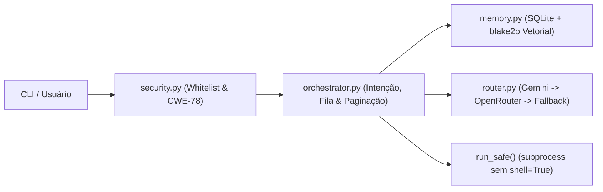

# `Public-Jarvis`

Orquestrador assíncrono em **Python** para agentes autônomos, combinando **roteamento Multi-LLM com failover (Gemini API -> OpenRouter -> fallback local)**, **memória episódica/vetorial persistente em SQLite**, **fila de tarefas** e **execução shell segura (CWE-78)**.

---

## Arquitetura



---

## Módulos

- **`config.py`:** carregamento tipado com Pydantic (`JarvisSettings`), leitura de `.env` via `python-dotenv` e descarte automático de placeholders.
- **`security.py`:** validação de usuários (`ALLOWED_USERS`) e execução de comandos sem `shell=True`, com whitelist estrita de binários/subcomandos e bloqueio de operadores de injeção (`;`, `|`, `&&`, `$()`).
- **`memory.py`:** `JarvisMemoryStore` em SQLite com tabelas `memories` e `tasks`, vetorização determinística via `hashlib.blake2b` (L2-normalizada) e busca híbrida (cosseno + sobreposição lexical).
- **`router.py`:** `MultiLLMRouter` assíncrono (`httpx.AsyncClient`) com failover automático `Gemini -> OpenRouter -> local_fallback`.
- **`orchestrator.py` & `cli.py`:** classificação de intenções (`shell`, `code`, `analysis`, `memory`, `general`), registro de tarefas, paginação de respostas longas e CLI (`ask`, `remember`, `tasks`, `health`).

---

## Execução Rápida

```bash
# 1. Criar ambiente virtual e instalar dependências
python3 -m venv .venv
source .venv/bin/activate
pip install -r requirements.txt

# 2. (Opcional) Configurar chaves de API
cp .env.example .env

# 3. Verificar saúde do sistema (sem expor segredos)
PYTHONPATH=src python -m public_jarvis.cli health

# 4. Armazenar memória e consultar o orquestrador
PYTHONPATH=src python -m public_jarvis.cli remember "arquitetura" "Failover Gemini -> OpenRouter -> Local"
PYTHONPATH=src python -m public_jarvis.cli ask "Como funciona o failover?"
PYTHONPATH=src python -m public_jarvis.cli tasks
```

---

## Testes

```bash
PYTHONPATH=src pytest -v
```

A suíte cobre **52 testes** (validação de configurações e segurança CWE-78, vetorização determinística e SQLite, failover Multi-LLM, orquestração e subcomandos da CLI).
